<p align="center">
  
</p>

<p align="center">
  
</p>

<p align="center">
  <a href="https://github.com/Fideloo">
    
  </a>
  
  
  
</p>

<p align="center">
  
</p>

### `> whoami`

```yaml
identity:
  name: "Luiz Gustavo Cardoso Fidélix"
  alias: "Fidelo"
  craft: "Full-Stack Developer @ B2RISE"
  origin: "Brazil 🇧🇷"

manifesto:
  engineering:
    - "Full-stack development with modern web ecosystems"
    - "AI integrations, intelligent workflows & MCP (Model Context Protocol)"
    - "Clean backend architectures & resilient services"
    - "Building useful, high-impact and scalable software"

  outside_the_terminal:
    - "Story-driven games with emotional resonance"
    - "Music, cinematic soundtracks & fingerstyle acoustic guitar"
    - "Cooking comfort food after long debugging sessions"
    - "Exploring intricate fictional worlds and game lore"
```

---

### `>Core Tech Arsenal`

<p align="left">
  <!-- Languages & Runtimes -->
  
  
  
  
  <!-- Frontend & Frameworks -->
  
  

  <!-- Modern AI, Systems & DB -->
  
  
</p>

---

### `>Side Quests & Narrative Lore`

<table>
  <tr>
    <td width="33%" valign="top">
      <h4>🦋 Arcadia Bay</h4>
      <p><i>"This Action Will Have Consequences."</i></p>
    </td>
    <td width="33%" valign="top">
      <h4>⌚ 2:15 • Jackson</h4>
      <p><i>"Endure and Survive."</i></p>
    </td>
    <td width="33%" valign="top">
      <h4>💾 Night City Relic</h4>
      <p><i>"City of Dreams"</i></p>
    </td>
  </tr>
</table>

---

### `>Code Telemetry`

<p align="center">
  
</p>

---

### `>Let's Connect & Build`

<p align="center">
  <a href="https://linkedin.com/in/fideloo" target="_blank">
    
  </a>
  <a href="mailto:luizfidelix@gmail.com">
    
  </a>
  <a href="https://github.com/Fideloo">
    
  </a>
</p>

<p align="center">
  <sub><b>Luiz Gustavo (Fidelo) Cardoso Fidélix</b> • <i>"City of Dreams"</i></sub>
</p>
